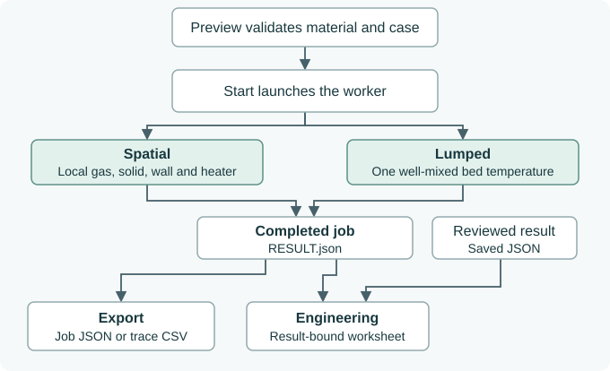

# Project map

This directory is a complete working project. Its app and solver do not need the surrounding research archive.

Read [Using the DAC model](../model/report/project/user_guide.html) for the user
workflow. This page maps that workflow to the code.

## Follow one calculation

Start with **Reviewed Lewatit (65% RH, 48 h)** under **Comparison presets**. The table follows the working app from that button to a result. Python paths below are relative to `model/`. The physics reference derives the [balances and material laws](../model/report/project/model_reference.html).

| Stage | What calls what | Data passed or saved |
|---|---|---|
| Launch and material selection | `run.py serve` calls `app.server.main`. `build_server` installs the concurrent screening manager. Browser function `loadMaterial` in `app/mof_screening/static/app.js` requests `/api/mof-screening/materials/<id>`. `routes.get` calls `contract.load_builtin_material`. | A selectable material JSON with its units, equilibrium family, source and operating limits. Case presets come from `config/mof_screening/defaults.json`. |
| Preview | `app.js: previewCase` reads the form and posts the material and case to `/api/mof-screening/preview`. `routes.post` calls `manager.preview`, which calls `contract.build_case` and `contract.preview_payload`. | The server validates the material, case and their compatibility, computes their hashes and saves a preview ID. Editing an input invalidates the browser preview. No time integration occurs. |
| Start | `app.js: startJob` posts that preview ID to `/api/mof-screening/start`. `ConcurrentMofScreeningManager.start` in `parallel_manager.py` checks readiness and executable identity, consumes the preview and calls `launch_worker`. | A job ID, `input_material.json`, `input_case.json` and `STATE.json` in the job directory. The independent worker reads these saved inputs. |
| Choose the engine | `process_worker.execute_job` calls `MofScreeningManager._run_job` in `manager.py`. It dispatches on `case.engine` to `runtime.run_spatial` or `runtime.run_lumped`. Both build the material adapter and load the weather window. | Normalized material, operating case, initial state, weather, solver controls and progress/cancellation callbacks. The representation is chosen once for the job. |
| Spatial calculation | `run_spatial` builds the geometry and half-bed, then calls `spatial.one_cycle`. It constructs `spatial.cycle_rhs` for each phase and passes the resulting derivative function to SciPy. At each evaluation the local gas state supplies partial pressures, and the material adapter supplies rates and energy derivatives. | Gas moles, site loadings, gas and solid temperatures, wall and heater temperatures, and boundary meters. Accepted states are sampled for traces and phase endpoints. |
| Lumped calculation | `run_lumped` calls `lumped_port.weather_driver.run_weather_session`. Its `core_closure` calls `lumped_port.engine.run_cycle(rhs_only=True)` to obtain phase derivatives. The weather driver invokes `solve_ivp` with those derivatives. | One well-mixed bed state, phase/weather boundaries, integrated meters and a checkpoint. The weather driver owns the integration loop. |
| Monitor and finish | `app.js: pollJob` reads job status. Worker callbacks update progress during integration. Both runtime branches call `evaluation.annotate_result`. On success `manager._run_job` writes `RESULT.json` and marks the job completed. | Completion, material support, target attainment, numerical diagnostics and conservation are separate fields. Interrupted jobs retain available diagnostics. |
| Read or export | `routes.get` dispatches a job's `/export?format=json` or `/export?format=csv` request to `manager.export`. For a reviewed result, `/api/result?result=reviewed:<name>` reads the indexed saved file. | JSON retains inputs, states, traces, metrics and source identities. The job CSV contains sampled traces. A trace sample is distinct from an integrated product or energy meter. |
| Engineering | `app.server.Handler` sends the selected result ID to `engineering.calculate`. It calls `load_result`, `read_worksheet` and `assess`. `engineering.save` binds the worksheet to the result SHA-256 and checks its revision. | `reviewed:<name>` selects a hash-checked archived result and `job:<id>` selects a completed local run. Unpriced components stay unknown. Opening or pricing a worksheet does not start a simulation. |

### Trace a reported number

For the humid Lewatit example, `case.weather.relative_humidity = 0.65` becomes inlet water partial pressure in `weather.WeatherHour`. In the spatial derivative, the **local** water partial pressure sets the water uptake target; stored water then changes the CO₂ target. `material.rates` returns the gas species sink, and withdrawal during the collection portions feeds the product meter. `runtime.run_spatial` combines the symmetry-scaled meter increments across the 48-hour horizon. The saved `metrics.collected_CO2_kg` is 5.140642 kg. Results and Engineering report its daily equivalent of 2.570321 kg/day. This chain can be checked against the [saved export](data/submission/results/lewatit_humid.json) and the [worked mass and electricity calculation](../model/report/project/model_reference.html#component-conservation-and-a-worked-export).

For a new case, edit the equipment, weather or phase settings. For a material of an existing equilibrium family, follow its JSON inputs into `materials.build_material_adapter`. When reviewing a genuinely new constitutive law, check its equilibrium target, directional rates, map from storage sites to gas species and energy derivatives together. The **3D DAC setup** follows a separate path through `docs/assets/geometry/` and `docs/data/`. The default replay reads `lewatit_humid_cycle.json`, extracted from the reviewed humid Lewatit export by `tools/build_lewatit_replay.py`. Three dry cases use `process_saved_cycles_v1.json`. **Add run** reads a local completed job or a native result JSON through `add-run.js`. `native-result.mjs` maps the saved phase records and bed states into cycle-relative samples for the same playback controls. Browser storage keeps the compact replay.

### Follow a steam, Purolite or aging result

For a direct-steam case, the spatial runtime uses the axial wet-bed calculation in `screening/mof_screening/direct_steam.py`. Read its steam inlet, free-liquid, drain and generator meters alongside the outlet product. The indirect steam jacket transfers heat across the wall and keeps steam outside the bed. [Heat-source equations and accounting](../model/report/project/model_reference.html#direct-steam-screening-results)

The Purolite record is `materials/screening/purolite_a110_humid.json`. Its equilibrium family selects `screening/mof_screening/purolite.py`, which computes a water loading, a humidity-conditioned CO₂ target and both rates. For the equal-mass comparison, the [CSV](data/resin-comparison-65rh.csv) identifies the exact case and solver shared by the two runs.

**Bed aging** reads [four fixed-capacity runs](data/bed-aging-lewatit.json) through `docs/assets/ui/bed-aging.js`. The page maps cycle count or measured capacity to capture and electricity. There is no time-evolving degradation state in the cycle solver.

## Files and directories

| Location | Purpose |
|---|---|
| `model/run.py` | Portable app launch and environment check |
| `model/launcher.py`, `START.cmd`, `STOP.cmd` | Windows launch, ownership checks and shutdown |
| `model/app/server.py`, `engineering.py` | Local pages, reviewed results and result-bound engineering |
| `model/app/mof_screening/` | Material, case, preview and simulation interface |
| `model/screening/mof_screening/` | Current material laws, spatial engine, lumped companion and run management |
| `model/screening/` | Shared geometry, airflow, heat, pressure, pump and water functions |
| `model/materials/screening/` | Material packages and normalized weather |
| `model/materials/screening/source_evidence/` | Exact dry inputs required to verify saved sensitivity packages |
| `model/config/mof_screening/` | Defaults, spatial settings, limits and execution identity |
| `model/equipment/` | Pump reference data |
| `docs/data/submission/` | Reviewed exports, audits, summary tables and source evidence |
| `model/report/project/` | Main report, equations, evidence, user guide and PDF |
| `docs/assets/geometry/` | 3D viewer and saved cycle playback |
| `model/tests/`, `tests/` | Current numerical, application and viewer checks |
| `tools/` | Installation, report rendering, result audit and release packaging |

## Why supporting files remain

The `.qmd` and Markdown files are editable documentation sources; their HTML and
PDF outputs let reviewers read them without a renderer. JSON exports preserve
the full calculation, while CSV tables provide summaries or traces. Tests and
their fixtures reproduce specific numerical and application behavior; repeated
case inputs inside distinct fixture jobs preserve each test's recorded context.

The license, third-party notices, dependency lock, source identities and release
manifest support sharing and verification. The `.venv/` environment, Python
caches and `model/outputs/` are local runtime files and are excluded from the
review ZIP and Git. They are not additional model versions.

New jobs and cost worksheets go under `model/outputs/`, which is local and excluded from the repository. The 3D replay uses illustrative equipment geometry and saved simulation output.

Saved result identities are preserved. The small source snapshot under `docs/data/submission/solver_source/` documents the numerical extension used by certain reviewed sensitivities; it is evidence, not another runnable app.

The material selector is defined in `model/config/mof_screening/defaults.json`. It includes exploratory scenarios, dry parent laws and synthetic examples. Each case records the exact material package. Historical source-path strings inside saved provenance identify original evidence. The standalone tests resolve the required tables and fixtures locally.
