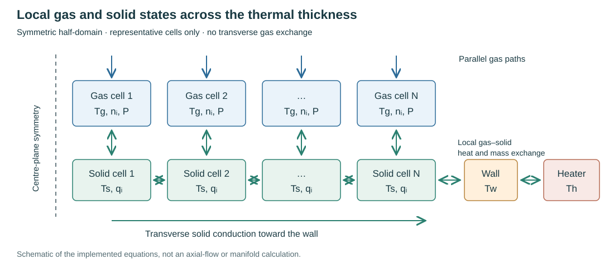

## Domain and state variables

The spatial engine is `screening/mof_screening/spatial.py`. It resolves the **transverse thermal thickness** of a symmetric bed, with parallel gas paths. It is not an axial breakthrough model. In the reported case the full bed is 16 mm thick and the half-domain has 16 cells. Gas and solid temperatures, gas species inventories and adsorbate storage are local states. Heater, wall and cumulative boundary meters complete the state vector.

The gas species are CO₂, H₂O, N₂ and O₂. Adsorbate storage can have extra CO₂ reservoirs or sites; a fixed species mapping sums their gas-phase contributions. All loadings refer to the complete dry shaped material. The full-device dry mass is split once for the half-domain. Reported device totals apply the symmetry factor once.

$$
L_{1/2}=L/2,\qquad \Delta x=L/(2N),\qquad
m_{s,1/2}=m_{s,\mathrm{device}}/2.
$$

For cell gas volume $V_{g,j}$ and gas temperature $T_{g,j}$, ideal-gas closure gives

$$
P_j=\frac{RT_{g,j}}{V_{g,j}}\sum_i n_{i,j},\qquad
y_{i,j}=\frac{n_{i,j}}{\sum_k n_{k,j}},\qquad p_{i,j}=y_{i,j}P_j.
$$

Feed moisture is set by relative humidity at the ambient temperature, not at the regeneration setpoint:

$$
y_{w,\mathrm{in}}=\frac{\mathrm{RH}\,p_{\mathrm{sat}}(T_a)}{P_a},\qquad
y_{c,\mathrm{in}}=(1-y_{w,\mathrm{in}})z_{c,\mathrm{dry}}.
$$

The implementation checks the domain of its saturation correlation. A declared hot-state humidity diagnostic is not a new high-temperature water-property fit.

### Geometry, inventory and initial conditions

The case specifies dry shaped mass $m_s$, full thickness $L$, face area $A$ and bed void fraction $\varepsilon$. The runtime derives the volume and densities from these four inputs. The gas volume includes the interparticle void and the specified dead volume.

$$
V_b=AL,\qquad \rho_b=m_s/V_b,\qquad
\rho_p=\rho_b/(1-\varepsilon),\qquad V_g=\varepsilon V_b+V_{\mathrm{dead}}.
$$

In the reviewed 10 kg case, $A=1.73611$ m² and $L=0.016$ m, giving $V_b=0.02778$ m³, $\rho_b=360$ kg/m³ and $\rho_p=600$ kg/m³. With $\varepsilon=0.40$ and 0.0005 m³ of dead volume, the full-device gas volume is 0.01161 m³. Each of the 16 equal half-bed cells has 0.3125 kg dry material and is 0.5 mm thick. The hydraulic path in the pressure-loss estimate is the full 16 mm. The conduction path from the wall to the centre plane is 8 mm.

`clean_dry` initializes all adsorbed loadings to zero. The gas spaces still contain the chosen ambient mixture at the initial pressure and temperature. `equilibrated_with_first_weather` initializes the solid at the material's equilibrium with that mixture. Subsequent phases inherit the preceding inventories and temperatures. Restarting every adsorption phase with an empty bed would give a different production estimate.

### Weather and local partial pressures

For a fixed case, the same forcing is applied across the horizon. With Pully weather, the model reads the normalized hourly observations in chronological order. `WeatherWindow.at` selects the hourly interval for the elapsed simulation time. The feed water mole fraction uses Buck saturation pressure at the ambient temperature. The remaining dry fraction contains the specified CO₂ and the balance of N₂ and O₂ in the proportions 0.7905 and 0.2095.

For a check on units, the reviewed humid feed at 25 °C, 100,000 Pa and 65% RH gives $p_{w,\mathrm{in}}=2059.55$ Pa. At 420 ppm CO₂ on a dry basis, the wet-feed CO₂ partial pressure is $100000(1-0.02059545)(420\times10^{-6})=41.13$ Pa. Inside each cell, the solver uses its current **gas** temperature to calculate $p_i$ and evaluates the material law at its current **solid** temperature. In particular, local water activity $a_w=p_w/p_{\mathrm{sat}}(T_s)$ can change during regeneration even at constant inlet RH. The selected material specifies the local saturation correlation.

The following functions construct the geometry, weather and initial state: `runtime.derived_geometry`, `geometry.build_bare_geometry`, `weather.WeatherHour`, `spatial.build_model` and `spatial.initial_state`.

## Adsorption and component balance

The material adapter supplies equilibrium loading $q_a^*$, rates $k_a$, storage energy and its derivatives. Each storage state follows a linear driving force law:

$$
\dot q_{a,j}=k_{a,j}(q^*_{a,j}-q_{a,j}).
$$

For a species-to-storage map $S_{ia}$, the local gas balance is

$$
\dot n_{i,j}=\dot n_{i,j}^{\mathrm{in}}-\dot n_{i,j}^{\mathrm{out}}
+\dot n_{i,j}^{\mathrm{leak}}-m_{s,j}\sum_a S_{ia}\dot q_{a,j}.
$$

The material package determines which equilibrium expression is used. The supported families include independent Langmuir/Sips laws, reference-curve temperature shifts, split-rate reservoirs with shared thermodynamics, explicit two-site CO₂ storage and the Lewatit water-dependent treatment. These families are not interchangeable descriptions of the same specimen.

A split-rate empirical response uses two storage reservoirs with nonnegative fractions that sum to one:

$$
q_c=q_f+q_s,\qquad q_f^*=f q_c^*,\qquad q_s^*=(1-f)q_c^*,\qquad 0\le f\le1.
$$

It can represent more than one protocol timescale without establishing two independently measured thermodynamic sites. Stored-water scenarios make the CO₂ target depend on current adsorbed water. Their humid coupling and transfer assumptions remain part of the material evidence. An unwrapped `dry_only` package has exactly zero water storage, rate and adsorption energy and requires exactly zero feed RH.

The material records identify pressure and temperature support separately from the numerical extension of a curve. Named extrapolation scenarios retain the evidence limits. The temperature registry distinguishes a scenario guard from a demonstrated physical material limit.

### Selecting a material law

`materials.build_material_adapter` dispatches on `equilibrium_family`. For a material with a `humidity_candidate` section, it first resolves the recorded dry parent, then wraps that adapter with the candidate's water law. The resulting adapter supplies site rates, the mapping to gas species and the stored-energy derivatives to both engines. The following table identifies the dry/reference calculation beneath any humid extension.

| Material record | CO₂ calculation | Inputs that determine the result |
|---|---|---|
| Hypothetical mmen-inspired and synthetic examples | Independent Langmuir CO₂ and Sips water | Reference loading and pressure, capacities, heats and directional rate coefficients |
| mmen-Mg₂(dobpdc), HOB powder and PVDF, MOF-808-Lys and TAPA, TEPA(50), both PEI/MIL-101 variants, COF-999, Low et al. Lewatit | Reference isotherm shifted in pressure | Recorded curve, its measurement temperature, assumed or fitted heat and rates |
| COF-1000 | Two rates sharing one shifted isotherm | One equilibrium curve, capacity fractions and separate fast/slow rate coefficients |
| Shaped CALF-20 | Two concentration-based Langmuir sites | Separate capacities, affinities and energies, with a tabulated water relation |
| Young et al. Lewatit | Water-weighted dry and wet Toth curves, plus GAB water | Published parameter sets, evolving stored water, kinetic coefficients and the record's temperature policy |

### Langmuir, Sips and reference-curve models

In the independent family, $q_r$ at partial pressure $p_r$ anchors CO₂ affinity at $T_r$. Water has a Sips exponent $\nu$ and a half-loading affinity. The optional penalty $\alpha$ links the two equilibrium targets. Nitrogen and oxygen follow Henry laws in this family.

$$
b_{c,r}=\frac{q_r}{p_r(q_{s,c}-q_r)},\quad
q_w^*=q_{s,w}\frac{(b_wp_w)^\nu}{1+(b_wp_w)^\nu},\quad
q_c^*=\frac{q_{s,c}b_cp_c}{(1+b_cp_c)(1+\alpha q_w^*)}.
$$

With positive reference heat magnitude $Q_{i,r}$ and $\Delta C_{p,i}=C_{p,g,i}-C_{p,a,i}$ in J/(mol K), the affinity factor used for these species is

$$
\ln\frac{b_i(T)}{b_i(T_r)}
=\frac{Q_{i,r}}{R}\left(\frac1T-\frac1{T_r}\right)
+\frac{\Delta C_{p,i}}{R}\left[1-\frac{T_r}{T}-\ln\frac{T}{T_r}\right].
$$

For a measured reference curve at $T_m$, the CO₂ target instead comes from mapping the current pressure back to the reference temperature:

$$
p_{\mathrm{map}}=p_c\exp\left[\frac{Q_c}{R}\left(\frac1{T_s}-\frac1{T_m}\right)\right],
\qquad q_c^*=q_{\mathrm{curve}}(p_{\mathrm{map}}).
$$

`DryActivityShiftReferenceEvaluator` interpolates loading in log pressure with a shape-preserving piecewise cubic (PCHIP). Below the first positive point it uses a straight line to the origin. Above the final point it holds the final loading. The material record identifies the measured range and the evidence for temperature transfer. COF-1000 partitions this target between two reservoirs. Shaped CALF-20 instead evaluates each site $a$ at $c=p_c/(RT_s)$:

$$
b_a(T_s)=b_{0,a}\exp[-u_a/(RT_s)],\qquad
q_a^*=q_{s,a}\frac{b_a(T_s)c}{1+b_a(T_s)c},\qquad q_c=q_1+q_2 .
$$

Here $u_a$ is the signed energy parameter stored for that site. In the native shaped CALF-20 record, the separate water curve is evaluated at a temperature-shifted reference activity. The exploratory humid record declares its own water treatment. Numerical interpolation between observations does not establish hot, dilute or humid behavior beyond their support.

### How humidity changes the reviewed Lewatit result

In the matched 48-hour Lewatit runs the gas supplies local $p_c$ and $p_w$. At the solid temperature the Young et al. adapter evaluates a Guggenheim–Anderson–de Boer (GAB) water target and a weighted average of two Toth CO₂ targets [@young2021]. With $a_w=p_w/p_{\mathrm{sat}}(T_s)$, monolayer loading $q_m$, and temperature-dependent GAB coefficients $C,K$,

$$
q_w^*=\frac{q_m C K a_w}
{(1-Ka_w)[1+(C-1)Ka_w]} .
$$

For each of the dry and wet CO₂ branches,

$$
q_b(T,p_c)=q_{\infty,b}(T)
  \frac{b_b(T)p_c}{[1+(b_b(T)p_c)^{\tau_b(T)}]^{1/\tau_b(T)}} .
$$

The implemented parameter convention is $b_b=b_{0,b}\exp[Q_{0,b}/(RT)]$, $q_{\infty,b}=q_{\infty,0,b}\exp[\chi_b(1-T/T_r)]$ and $\tau_b=\tau_{0,b}+\alpha_b(1-T_r/T)$. `young2021.py` gives the separate dry and wet coefficients and the GAB temperature functions. The fraction assigned to wet sites depends on the **current stored** water $q_w$, with $q_{\mathrm{crit}}=1.532$ mol/kg. It is zero at $q_w=0$:

$$
w=\exp(-q_{\mathrm{crit}}/q_w)\quad(q_w>0),\qquad
q_c^*=(1-w)q_{\mathrm{dry}}+w q_{\mathrm{wet}}.
$$

Water therefore affects CO₂ after it has loaded onto the material. An instantaneous change in inlet RH does not immediately impose a new wet-site fraction. Both loadings approach their targets with the applicable directional rates. The matched exports use the advisory-temperature material with the named BDF trial-recovery policy. Its identifier contains `dry_bdf_recovery` in both exports. Feed humidity is defined in `case.weather`. The material's measured coupled temperature range is 25–70 °C. At the 116 °C regeneration request the model extrapolates the equations. The advisory implementation uses IAPWS for local saturation pressure, while the original strict Young implementation uses Buck. The saved RH trace has a separate diagnostic convention described [below](#reading-saved-diagnostics).

### Other stored-water scenarios

For the COFs, MOF-808 variants and PEI/MIL variants that specify a chemical-potential shift, the wrapper evaluates the dry CO₂ law with an effective pressure. With $x=q_w/q_{\mathrm{norm}}$, the record's coefficients $a_k$ and temperature exponent $\eta$ give

$$
p_{c,\mathrm{eff}}=p_c\exp\left[(T_r/T_s)^\eta\sum_{k\ge1} a_k x^k\right].
$$

The TEPA proxy instead adds a bounded loading $q_{\mathrm{add}}[1-\exp(-x^m)]\,b(T_s)p_c/[1+b(T_s)p_c]$ to the dry target. For independent-water candidates such as HOB/PVDF or mmen, water still adds inventory, sorption heat and pump load while the direct CO₂ target follows the dry law. Depending on the record, the water target comes from a Sips anchor, a line through one measured node, a PCHIP curve, a temperature/activity table or the native water relation. The package identifies which coefficients were measured, fitted, transferred or assumed.

In each reservoir the model uses the adsorption coefficient when $q_a^*\ge q_a$ and the desorption coefficient when $q_a^*<q_a$. Thus a cell can still adsorb during a nominal desorption phase if its local target exceeds its current loading. The gas sees the sum of rates for all reservoirs assigned to its species.

## Energy and heat transfer

The gas uses constant species heat capacities and an explicit internal-energy/enthalpy reference. Stored energy includes gas, dry solid, adsorbed material, wall and heater contributions. Loading-energy derivatives are supplied by the material law, avoiding a second independent addition of adsorption heat.

The solid energy derivative has the general form

$$
\frac{dU_s(T_s,\boldsymbol q)}{dt}
=\left(\frac{\partial U_s}{\partial T_s}\right)_{\boldsymbol q}\dot T_s
+\sum_a\left(\frac{\partial U_s}{\partial q_a}\right)_{T_s}\dot q_a.
$$

Let $\dot E_s$ include heat received and the internal energy carried by gas entering storage. Subtracting the energy stored through loading changes gives the solid temperature rate.

$$
\dot T_s=\frac{\dot E_s-\sum_a U_{q_a}\dot q_a}{U_T}.
$$

The spatial case uses an assumed gas–solid interfacial area of 2,400 m² per m³ of bed. This stays fixed when particle diameter changes. A geometry or particle-size sensitivity must review that assumption. Finite gas-to-solid heat exchange uses

$$
\dot Q_{gs,j}=h_{gs}A_{gs,j}(T_{g,j}-T_{s,j}).
$$

Neighboring solid cells exchange heat through the specified effective conductivity:

$$
\dot Q_{j\rightarrow j+1}=\frac{k_{\mathrm{eff}}A}{\Delta x}
(T_{s,j}-T_{s,j+1}).
$$

There is no extra transverse gas-conduction term on top of that effective bulk conductivity. The symmetry plane has zero normal heat flux. Wall/heater heat capacities, transfer conductances, ambient losses and bounded actuator requests determine the boundary behavior. Heater power is an electrical input, not an imposed uniform bed temperature. A resistance wire inside a real bed needs its own transfer representation and temperature measurements.

### Balances actually integrated in a spatial cell

Let $F_j$ be feed, $B_j$ leakage and $W_j$ withdrawal in mol/s for one half-domain cell. Let $\phi_j=h_{gs}A_{gs,j}(T_{g,j}-T_{s,j})$ be heat flowing **into** the solid. The spatial engine integrates the gas temperature together with the species inventories. For inlet and leak gas at $T_a$ its gas temperature equation is

$$
n_j\bar C_{v,j}\dot T_{g,j}
=(F_j\bar C_{p,F}+B_j\bar C_{p,B})(T_a-T_{g,j})
+RT_{g,j}(F_j+B_j-W_j)-\phi_j .
$$

Here $n_j=\sum_i n_{i,j}$ and the barred heat capacities are mole-fraction weighted. Uptake already removes gas internal energy with the transferred moles. With reference temperature $T_r$ the code uses $u_i^g=(C_{p,i}-R)(T_g-T_r)$ and $h_i^g=C_{p,i}(T_g-T_r)+RT_r$. Thus $h_i^g-u_i^g=RT_g$ at the same temperature. The cell's conservative **solid** equation is

$$
m_j\left(c_{p,s}+\frac{\partial e_a}{\partial T_s}\right)\dot T_{s,j}
=\dot Q_{\mathrm{cond},j}+\phi_j+
m_j\sum_a\dot q_{a,j}
\left[u^g_{i(a)}(T_{g,j})-\frac{\partial e_a}{\partial q_a}\right].
$$

$e_a(T_s,\boldsymbol q)$ is stored adsorbate energy in J per kg dry shaped material. The difference in brackets is the energy transferred per mole taken up. Using both this term and a separately added heat of adsorption would count the same transfer twice. This is why a new material law must supply its caloric terms as well as its isotherm.

### Wall, heater and cooling boundary

Cell 1 lies at the symmetry plane. The last cell touches the wall through a contact resistance and half of the boundary cell's conduction resistance. For $N>1$,

$$
G_{ss}=k_{\mathrm{eff}}A/\Delta x,\qquad
R_{ws}=(h_{\mathrm{contact}}A)^{-1}+\Delta x/(2k_{\mathrm{eff}}A),\qquad
\dot Q_{ws}=(T_w-T_{s,N})/R_{ws}.
$$

For a one-cell **spatial** calculation the code uses the full half-thickness in the wall conduction resistance. It still has distinct gas, solid, wall and heater temperatures. For the reviewed electric heater, the two boundary-node balances, written with half-device powers and capacities, are

$$
C_h\dot T_h=P_h-G_{hw}(T_h-T_w),\qquad
C_w\dot T_w=G_{hw}(T_h-T_w)-\dot Q_{ws}-U_{\mathrm{loss}}A(T_w-T_a)-\dot Q_{\mathrm{wall},cool}.
$$

The coldest solid cell supplies the spatial feedback temperature. The heater command is capped at rated power and tapers as the heater approaches its own temperature ceiling. Wall cooling also requires a temperature difference, finite wall conductance and capacity left over after the pump-inlet cooler. The hottest bed cell is checked against any active material guard. Control temperature, local peak and requested setpoint therefore refer to three different quantities.

### Well-mixed companion

The lumped engine carries one temperature $T$ for gas, sorbent, represented metal and heater. Pressure follows $nRT/V_g$. Adsorption uses a fixed-total-moles control policy and limits positive uptake demand by available feed for each species. The common material interface still calculates the target and directional rates. The lumped first law can be written

$$
C_{\mathrm{eff}}\dot T=\dot Q_h-\dot Q_{\mathrm{cool}}-\dot Q_{\mathrm{loss}}
+\dot H_{\mathrm{in}}-\dot H_{\mathrm{out}}
-\sum_i u_i^g\dot n_i - m_s\sum_a
       \frac{\partial e_a}{\partial q_a}\dot q_a,
$$

with $C_{\mathrm{eff}}=m_s(c_{p,s}+\partial e_a/\partial T)+C_{\mathrm{metal}}+C_h+\sum_i n_i C_{v,i}$. Heating and cooling act at the mixed temperature. Gas–solid exchange, transverse conduction and wall-to-bed temperature lags have no independent states here. A spatial mesh refinement and a spatial/lumped comparison consequently answer different questions.

The whole-device first-law check compares inventory change with integrated boundary enthalpy and heat:

$$
r_E=\Delta U-\int(\dot H_{\mathrm{in}}-\dot H_{\mathrm{out}}+\dot Q_{\mathrm{net}})\,dt.
$$

The reported relative residual uses gross boundary exchange, so cancellation between large inward and outward terms does not create a misleading denominator:

$$
\epsilon_E=\frac{|r_E|}{\max(|\Delta U|,E_{\mathrm{gross}},1\ \mathrm J)}.
$$

`energy_balance.py` retains the older net-exchange diagnostic alongside this value. The gross criterion is $10^{-6}$; it is an accounting threshold, not a prediction-error estimate. The raw species balances and absolute residuals remain necessary evidence.

## Airflow, vacuum and collection

For a packed-bed hydraulic estimate the model uses the Ergun relationship [@ergun1952] with declared particle diameter $d_p$, porosity $\varepsilon$ and superficial velocity $u$:

$$
\frac{\Delta P}{L}=150\frac{\mu(1-\varepsilon)^2}{\varepsilon^3d_p^2}u
+1.75\frac{\rho(1-\varepsilon)}{\varepsilon^3d_p}u|u|.
$$

The fan work follows the imposed flow and modeled pressure loss:

$$
P_{\mathrm{fan}}=Q\Delta P/\eta_{\mathrm{fan}},\qquad Q=uA.
$$

This does not represent a measured fan/system intersection or distributor uniformity. Screens, filters, fittings and an internal heater may add pressure loss.

Vacuum withdrawal uses the retained KNF N922 50 Hz reference curve and the pressure-control policy. The spatial control observable uses the maximum local pressure. The saved spatial endpoint compares the lowest cell pressure at the end of desorption with 1.05 times the request. Inspect the maximum pressure and spread in the traces to assess the rest of the bed. An ultimate-vacuum rating does not imply useful flow at that pressure. The current model does not qualify delivery into a 3 bar absolute destination.

The ideal inlet cooler/knockout has zero pressure drop and no line holdup in the common case. Its cooling request is allocated first within the shared 2 kW cooling capacity; remaining capacity is available to the bed wall. Water condensate, water vapor in product and adsorption exhaust are separate boundary flows. They are not additional stored inventory.

### From bed outlet to pump and product

The case translator selects one pump and the `reference_fixed_inlet_speed` interpretation. For the plotted reference-volume flow $Q_{\mathrm{curve}}(P)$ in m³/s and profile reference pressure $P_r$, the assumed inlet speed and molar capacity are

$$
S(P)=Q_{\mathrm{curve}}(P)P_r/P,\qquad
\dot n_{\mathrm{cap}}=S(P)P/(RT_{\mathrm{inlet}}).
$$

In spatial operation the throttle command is $\alpha=\mathrm{clip}[(P_{\max}-P_{\mathrm{req}})/(500\ {\mathrm{Pa}}),0,1]$. Capacity uses the **minimum** cell pressure as suction pressure. The outlet mixture is formed using the prescribed channel shares and gas enthalpies. The single pump's withdrawal is then apportioned to those channels. In the lumped pump/conditioner path the opening uses the mixed pressure, a 2,000 Pa band and a 0.02 offset. An identical pressure request can therefore yield different evacuation times in the two representations.

The inlet conditioner cools only when needed, to $T_o=\min(T_{\mathrm{mix}},328.15\ {\mathrm{K}})$. Take one mole of raw bed gas with water fraction $y_w$, at suction pressure $P$. The water fraction in the conditioned vapour is $z=\min[y_w,p_{\mathrm{sat}}(T_o)/P]$. When liquid forms from a gas with a nonzero dry fraction, the remaining vapour fraction is $\gamma=(1-y_w)/(1-z)$. The liquid drain is $1-\gamma$ mol of water per mol of raw gas. All incoming CO₂ stays in the gas in this ideal knockout model.

The enthalpy difference between the raw inlet and the two outlet streams gives the cooling required per mole, $q_{\mathrm{cond}}$ (J/mol). The raw withdrawal $\dot n_b$ must satisfy both the conditioned-gas capacity and the cooling budget. When both bounds apply and are finite,

$$
\dot n_b=\alpha\min\!\left(\frac{\dot n_{\mathrm{cap}}}{\gamma},
\frac{\dot Q_{\mathrm{cool},max}}{q_{\mathrm{cond}}}\right),\qquad
\dot Q_{\mathrm{cond}}=\dot n_b q_{\mathrm{cond}}.
$$

Zero cooling duty removes the energy constraint. A closed valve or zero pump capacity gives zero withdrawal. The wall can use at most $\dot Q_{\mathrm{cool},max}-\dot Q_{\mathrm{cond}}$. In the reviewed case the shared cooling capacity is 2 kW and the coefficient of performance is 3. Both duties enter cooling electricity once. Thermal duty in watts and electrical power in watts have separate meters.

In the code, `airflow.airflow` adds the configured minor loss $K_{\mathrm{minor}}\rho u^2/2$ to the packed-bed drop. `pump_rates.rate_at_pressure` interprets the pump curve. `spatial.cycle_rhs` allocates withdrawal and `lumped_port.pump_conditioner.evaluate_pump_conditioner` closes the gas, liquid and cooling balances.

## Cycle and reporting basis

Adsorption and heated desorption last two hours each in the saved comparison. Evacuation lasts five minutes, with bounded cooling and passive repressurization. Product collection is active during desorption and cooling, including any collected product before the exact horizon ends.

$$
M_{c,\mathrm{product}}=MW_c\int_{\mathcal C}\dot n_{c,\mathrm{product}}\,dt,
\qquad
\dot M_{c,\mathrm{day}}=\frac{86400}{t_H}M_{c,\mathrm{product}}.
$$

Here $\mathcal C$ denotes the collection portions of the recorded horizon. A completed cycle's daily equivalent and the 48-hour cold-start average use different denominators and are kept separate.

$$
e_{\mathrm{CO_2}}=\frac{E_{\mathrm{electric}}}{M_{c,\mathrm{product}}},\qquad
E_{\mathrm{electric}}=E_h+E_f+E_p+E_{\mathrm{cool}}+E_{\mathrm{conditioning}}.
$$

Components are taken from the saved meters so shared cooling is not counted twice. Dry product purity excludes water; wet purity includes it. These fractions refer to the model's collection boundary.

### Switching conditions

| Phase | Spatial calculation | Collection in the reviewed case |
|---|---|---|
| Adsorption | Ambient feed, prescribed volumetric flow and a pressure-following vent. The phase ends on its timer. | Exhaust to vent |
| Evacuation | Pumped withdrawal for the configured duration. Bounded actuation responds to the bed energy imbalance. | Conditioned gas to vent |
| Heated desorption | Pumped withdrawal, bounded positive heating toward the requested temperature, timed hold. | Conditioned gas to product after the purge interval (zero in the reviewed case) |
| Cooling | Pump remains available. End when the wall and hottest bed cell are within 0.5 K above ambient, or when the cooling time expires. | Conditioned gas to product for the selected route |
| Repressurization | Passive refill with feed gas. End when the lowest cell pressure reaches 99.5% of ambient, or when the time limit expires. | No product withdrawal |

The lumped driver can also end evacuation on reaching the regeneration pressure. Its cooling and refill events use its single temperature and pressure. A time limit can advance a phase with an unmet target. The export records endpoint attainment separately from horizon completion. When the horizon falls inside a phase, only the elapsed portion contributes to inventories, energy and product.

### Component conservation and a worked export

For species $i$, form $N_i$ from gas inventory plus all adsorbed reservoirs mapped to that species. On a consistent device basis the integrated residual is

$$
r_i=\Delta N_i-N_{i,\mathrm{in}}+N_{i,\mathrm{vent}}+N_{i,\mathrm{prod}}
+\mathbf{1}_{i=\mathrm{H_2O}}N_{\mathrm{drain}}.
$$

Inlet includes leakage where present. Conditioned product and vent carry vapour, and the separate liquid drain carries water. The spatial runtime divides the absolute residual by the larger of boundary throughput and a floor of $10^{-9}$ mol, on the half-device ledger. The export uses a $10^{-5}$ relative mass criterion. The energy residual audits heat and enthalpy across its control volume. Fan and pump electrical inputs also count in reported operating electricity even though they do not all heat the bed.

The [humid Lewatit export](../../../docs/data/submission/results/lewatit_humid.json) illustrates the accounting. At 172,800 s its meters show 5.140642 kg of collected CO₂ and 28.113042 kWh of electricity. Dividing by two days gives **2.570321 kg/day**. Dividing electricity by the collected mass gives **5.468780 kWh/kg CO₂**. The electricity comprises 19.635473 kWh for heat, 0.098594 for the fan, 3.506436 for the pump, 4.872540 for cooling and zero additional conditioning electricity. The last value is an auxiliary component; the cooler duty is already included under cooling. The dry and wet product CO₂ mole fractions are 0.99433 and 0.56508 because wet purity includes water vapour in the collected gas. The meters cover ten complete cycles and part of the eleventh.

### Reading saved diagnostics

For the saved COF-1000 and CALF-20 humid exports, multiply `traces[].co2_loading_mean_mol_kg` by two to recover total CO₂ loading per kg of dry shaped material. This applies to plots, trace CSVs and working capacities calculated by subtracting two of those trace values. The 53 saved phase-end states in each export confirm the factor. Read each individual storage site directly from the state vector using `state_layout.q`. New spatial traces sum the CO₂ sites within each cell before averaging over cells.

The report's baseline and sensitivity tables use collected product and electrical boundary meters. Reconstructing those meters, including the partial final cycle, reproduces the reported values for all 16 complete exports. The matched Lewatit humidity comparison uses the same meter-based calculation.

In the saved Lewatit spatial exports, the Buck diagnostic used solid temperature in the gas partial-pressure calculation. During gas–solid temperature transients, this can affect `traces[].local_rh_min`, `local_rh_mean` and `local_rh_max`, plus the RH extrema copied into `water_burden` and `metrics`. To reconstruct RH at a saved phase boundary, use the gas inventory, cell gas volume and gas temperature for water partial pressure, then divide by saturation pressure at the solid temperature. The material balance already used the gas pressure. The 14 other reviewed exports used the material-specific humidity diagnostic.

In the well-mixed companion, trace rows sample phase ends. The full-horizon meters include any unfinished last phase.

## Numerical solution and qualification

The default spatial solver is SciPy BDF, with state-scaled absolute tolerances and a bounded numerical Jacobian over physical states. Independent cumulative meters have no feedback columns. A narrow dry-water trial-recovery policy is explicit in the relevant package. Completed mmen and TAPA rate sensitivities used the separately included branch-aware Jacobian, Radau solver and exact cell cache. Their original source hashes and numerical policies remain attached to the results; this extension is not presented as a new default for every material.

The primary cases use relative tolerance $10^{-7}$ and a maximum time step of 10 s. Solver success, finite sampled states, mass/energy closure, cycle repeatability, mesh independence and physical validation are separate checks. A completed integration establishes only that the requested numerical calculation finished. This release does not claim CSS, a mesh-qualified material ranking, validated hot humid behavior or device-level uncertainty bounds.

### Integration and evidence to inspect

The spatial solver integrates temperatures, gas moles, adsorbed loadings and boundary meters together. Its absolute tolerances differ by state: $10^{-5}$ K for temperatures, $10^{-9}$ mol/kg for loadings and $10^{-10}$ mol for cell gas inventories. `max_step_s` caps internal solver steps; `samples_per_phase` controls the reported trace resolution. Increasing the sample count alone therefore cannot demonstrate time-step or mesh convergence.

The lumped weather driver ends each integration segment at the next applicable phase, weather or horizon boundary and carries forward the accepted state. When diagnosing either engine, start with `horizon` and `checks`, then read `endpoint`, `temperature_policy`, `numerical_reliability` and the material's provenance. A small conservation residual tests the bookkeeping. A mesh study requires reruns with the same physical inputs at different cell counts and tolerances. Physical validation requires independent measurements appropriate to the material, geometry and operating conditions.

The [project map](../../../docs/project_map.html#follow-one-calculation) names the functions that run these equations and the result files they produce.

The 3D setup replays saved traces and phase-end fields. It holds the last saved field between boundaries. It does not resolve a new flow field or interpolate an axial adsorption front. Its equipment sizes and pipe arrangement are illustrative.

[Current results](index.html) · [Evidence and validation](evidence.html) · [Native result exports](../../../docs/data/submission/results.json)
